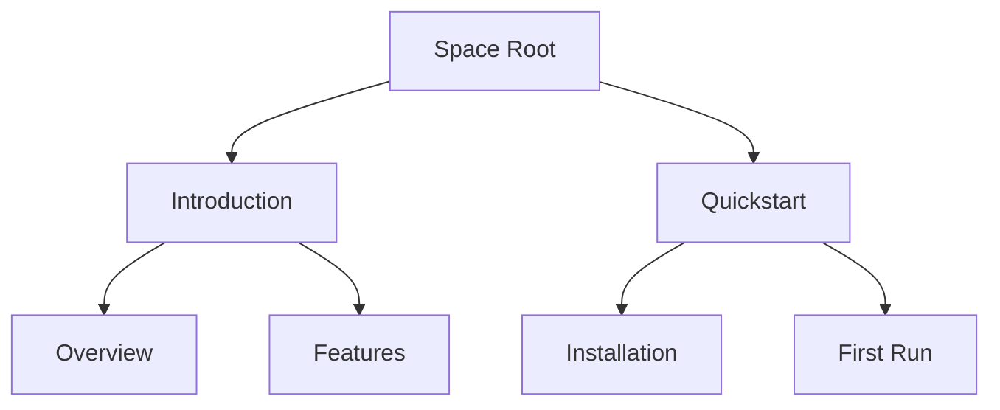

## Overview

Jostter Marinho organizes your project documentation into flexible `spaces`. You create spaces to group related docs, pages, and assets. Each space acts as a self-contained hub with its own structure, versioning, and access controls. Understand these core building blocks to build effective documentation workflows.

## Key Concepts

Use the following components to navigate Jostter Marinho's foundation:

<Columns cols={2}>
  <Card title="Documentation Spaces" icon="database" href="#documentation-spaces">
    Isolated environments for organizing pages, assets, and collaborators.
  </Card>
  <Card title="Pages and Nesting" icon="layout" href="#pages-and-nesting">
    Hierarchical structure for nested content and navigation.
  </Card>
  <Card title="Version Control" icon="git-branch" href="#version-control">
    Track changes with Git integration and rollback capabilities.
  </Card>
  <Card title="Permissions and Sharing" icon="users" href="#permissions-and-sharing">
    Granular controls for read, write, and admin access.
  </Card>
</Columns>

## Documentation Spaces

A documentation space is your top-level container. You start by creating a space for a specific project, like `api-docs` or `user-guide`. Spaces support unlimited pages and custom branding.

<Steps>
  <Step title="Create a Space" icon="plus">
    Navigate to the dashboard and select `New Space`. Enter a name and description.
  </Step>
  <Step title="Configure Settings" icon="settings">
    Set visibility (public/private) and link to a Git repository.
  </Step>
  <Step title="Add Pages" icon="file-text">
    Create your first page directly from the space overview.
  </Step>
</Steps>

<Callout kind="tip">
  Use one space per major project to keep documentation organized and scalable.
</Callout>

## Pages and Nesting

Pages form the content backbone. You nest pages to create intuitive hierarchies, like `/introduction` > `/quickstart` > `/authentication`.



This structure generates automatic navigation menus. Edit pages in MDX for rich components like `<Callout>` and `<Tabs>`.

## Version Control

Jostter Marinho integrates with Git for seamless version history. You commit changes, branch for features, and merge via pull requests. Roll back to any commit instantly.

<CodeGroup tabs="Git CLI,Web UI">
  ```bash
  git clone https://git.josttermarinho.com/your-space.git
  git checkout -b new-feature
  git add docs/concepts.mdx
  git commit -m "Add core concepts"
  git push origin new-feature
  ```
  ```javascript
  // Web UI equivalent
  // 1. Create branch from space settings
  // 2. Edit page and commit
  // 3. Open PR for review
  ```
</CodeGroup>

<Expandable title="Advanced Git Workflows" default-open="false">
  Connect external repos or use submodules for modular docs. Enable auto-publishing on merge to `main`.
</Expandable>

## Permissions and Sharing

Control access with role-based permissions. Assign viewer, editor, or admin roles to users or teams.

<Tabs>
  <Tab title="Viewer" icon="eye">
    Read-only access. Ideal for public docs or stakeholders.
  </Tab>
  <Tab title="Editor" icon="edit-3">
    Edit pages and assets. Cannot manage spaces or users.
  </Tab>
  <Tab title="Admin" icon="shield">
    Full control: users, settings, deletions.
  </Tab>
</Tabs>

Share via public links or embed codes. For teams:

| Role     | Pages | Assets | Settings | Users |
|----------|-------|--------|----------|-------|
| Viewer  | Read  | View   | No       | No    |
| Editor  | Edit  | Upload | No       | No    |
| Admin   | Full  | Full   | Yes      | Yes   |

<Callout kind="alert">
  Review permissions before making spaces public to avoid exposing sensitive content.
</Callout>

## Next Steps

<Columns cols={2}>
  <Card title="Quickstart" icon="rocket" href="/quickstart">
    Set up your first space in minutes.
  </Card>
  <Card title="Advanced Guides" icon="book-open" href="/guides">
    Dive into custom workflows and integrations.
  </Card>
</Columns>