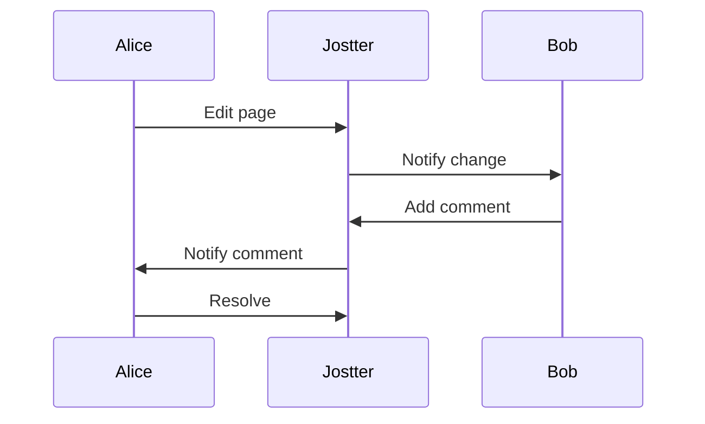

## Overview

Jostter Marinho provides a comprehensive set of tools to create, organize, and maintain project documentation. You can build rich documents with advanced editing capabilities, enable seamless search and navigation, support team collaboration, and customize your space to fit your workflow. These features make it ideal for technical docs, API references, and onboarding guides.

<Columns cols={2}>
  <Card title="Rich Editing Tools" icon="edit-3" href="#rich-editing">
    Create visually appealing docs with Markdown, embeds, and interactive components.
  </Card>
  <Card title="Search and Navigation" icon="search" href="#search-navigation">
    Quickly find content with full-text search and intuitive sidebar navigation.
  </Card>
  <Card title="Collaboration Workflows" icon="users" href="#collaboration">
    Work together in real-time with comments, version history, and permissions.
  </Card>
  <Card title="Customization Options" icon="settings" href="#customization">
    Tailor your docs with themes, layouts, and custom CSS.
  </Card>
</Columns>

## Rich Editing Tools

Compose documents using familiar Markdown syntax enhanced with MDX components for interactive elements like tabs, steps, and code groups.

<Tabs>
  <Tab title="Markdown Basics" icon="file-text">
    Start with standard Markdown for headings, lists, and code blocks.

    ````markdown
    # Welcome

    - List item
    - Another item

    ```javascript
    console.log("Hello, Jostter Marinho!");
    ```
    ````
  </Tab>
  <Tab title="Interactive Components" icon="components">
    Embed components directly in your MDX files.

    <Callout kind="tip">
      Components like `<Icon icon="star" />` add visual flair without extra setup.
    </Callout>
  </Tab>
</Tabs>

## Search and Navigation

You access content efficiently through a global search bar and hierarchical sidebar. Search supports fuzzy matching and highlights results across pages.

<Expandable title="Advanced Search Filters" default-open="true">
  Filter by tags, dates, or file types to narrow results quickly. For example, search for `api {endpoint}` to find all API-related endpoints.
</Expandable>

## Collaboration Workflows

Invite team members and manage permissions at the space or page level. Track changes with version history and discuss via inline comments.

<Steps>
  <Step title="Invite Collaborators" icon="user-plus">
    Go to space settings and add emails. Assign roles like Editor or Viewer.
  </Step>
  <Step title="Review Changes" icon="git-branch">
    Use the history panel to compare versions and revert if needed.
  </Step>
  <Step title="Add Comments" icon="message-circle">
    Highlight text and leave feedback. Resolve comments once addressed.
  </Step>
</Steps>



## Customization Options

Adapt Jostter Marinho to your brand with custom themes and layouts.

<CodeGroup tabs="Theme Config,CSS Overrides">
  ```json
  {
    "theme": {
      "primaryColor": "#ff6b1a",
      "fontFamily": "Inter, sans-serif"
    }
  }
  ```
  ```css
  .docs-sidebar {
    background: linear-gradient(135deg, #ff6b1a 0%, #ff8c42 100%);
  }
  ```
</CodeGroup>

<Board title="Customization Roadmap">
  <BoardColumn title="Planned" color="0" icon="calendar">
    <BoardCard title="Dark mode toggle" description="System preference detection" icon="moon" dueDate="2025-01-15" />
  </BoardColumn>
  <BoardColumn title="In Progress" color="1" icon="loader-2">
    <BoardCard title="Custom domains" description="Map your domain to docs" icon="globe" author="Team" />
  </BoardColumn>
  <BoardColumn title="Completed" color="2" icon="check-circle">
    <BoardCard title="Brand colors" description="Primary color picker" createdAt="2024-12-01" />
  </BoardColumn>
</Board>

<Callout kind="info">
  Explore these features in your Jostter Marinho space. Customize content to match your project's needs.
</Callout>